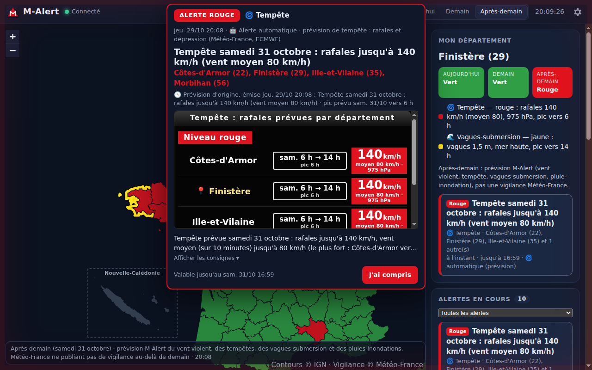
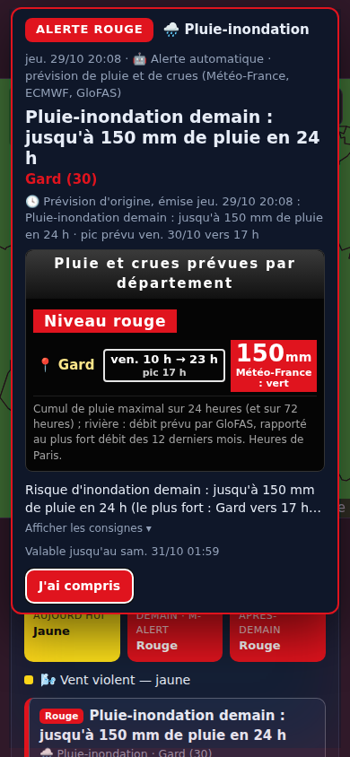

# M-Alert

Cette application diffuse des informations que j'envoie via mon module M-Alert, en fonction du département.

Pour recevoir les alertes que j'envoie (dont la source vient des centres météorologiques français comme Météo-France), il faut configurer votre département dans les réglages ou à la première ouverture de l'application.





## Fonctionnalités

- **Carte interactive** des départements, colorés selon la **vigilance Météo-France** (vert, jaune, orange, rouge, et rose pour le niveau **majeur** fixé par M-Alert), pour aujourd'hui et demain. Survolez un département pour voir les phénomènes (orages, vent, crues…).
- **Alertes en bannière** en haut de l'écran, dans le style de JQuake / GlobalQuake : cadre clignotant à la couleur du niveau, titre, départements concernés, description (un clic l'affiche en entier, avec les consignes) ; la carte reste visible et utilisable dessous. Les notifications de M-Alert et les annulations s'affichent de la même façon.
- **Son d'alerte** selon le niveau (information ; jaune et orange ; rouge ; majeure), avec un son dédié aux crues, inondations, tsunamis et vagues-submersion. Pour l'orange et le rouge, le son peut être répété jusqu'à « J'ai compris » ; le son majeur se répète toujours jusqu'à « J'ai compris ». Dans les réglages, chaque type d'alerte peut avoir **son propre son et son propre volume**, avec un bouton ▶ pour l'écouter.
- **Notification système** avec la description de l'alerte.
- **Tremblement de terre** : quatre niveaux, **Faible**, **Moyen**, **Élevé** et **Majeur**, avec la magnitude, la profondeur, l'intensité maximale (échelle japonaise **shindo**, de 0 à 7) et une **croix ✕ sur l'épicentre**, avec son propre son d'alerte (EEW, EEW 2 ou EEW léger, choisi par M-Alert). Pendant un séisme, les **ondes P et S** s'étendent sur la carte (cercles bleu et rouge) et le bandeau affiche le **compte à rebours** de leur arrivée dans votre département, avec un bip chaque seconde pendant les 10 dernières secondes avant l'onde S (« Couper le son » coupe l'alarme mais garde ce bip ; « Couper aussi le son du compte à rebours » le coupe), et l'**intensité attendue dans votre département** à côté de l'intensité maximale. Les **répliques** d'un séisme sont signalées comme telles. Pour un tsunami, la **hauteur des vagues** s'affiche quand elle est connue (estimation à vitesses moyennes : 6,5 km/s pour P, 3,75 km/s pour S). Les séismes de France métropolitaine peuvent être signalés automatiquement à partir des données de l'EMSC (Centre sismologique euro-méditerranéen), tout comme un risque de tsunami après un fort séisme en mer. Ils peuvent aussi être **détectés en quelques secondes par les stations sismiques** d'Epos-France (expérimental, comme GlobalQuake : mention « 📶 Détection par les stations ») ; leurs valeurs (magnitude, position) sont prioritaires et l'EMSC vient les confirmer. L'alerte s'affiche en **bandeau compact en haut** de l'écran pour laisser voir l'épicentre et les départements concernés.
- **Tsunami** : trois niveaux seulement, **Avis de tsunami** (jaune), **Avertissement de tsunami** (rouge) et **Avertissement majeur de tsunami** (rose), affichés comme dans JQuake par un trait **clignotant** (2 s allumé, 0,75 s éteint) de la couleur du niveau le long des côtes touchées, et un **tableau d'arrivée** comme au Japon : pour chaque côte, son niveau, l'heure d'arrivée prévue (« Déjà arrivé », « Arrivée imminente », heure exacte ou estimée « ≈ ») et la hauteur des vagues : annoncée par M-Alert, ou estimée d'après la magnitude et la distance (« ≈ », formule d'Abe ; la vague peut être plus haute dans les ports et les baies). Une alerte tsunami automatique n'est diffusée qu'après 3 minutes d'attente, le temps que M-Alert la vérifie. Les alertes **vagues-submersion** sont affichées de la même façon, sur les côtes, qui clignotent aussi.
- **Départements en alerte** remplis de la couleur du niveau, avec la même luminosité et les mêmes frontières noires que la vigilance. Un département **ajouté** à une alerte en cours clignote quelques secondes (comme les alertes précoces japonaises). Pendant un séisme, la magnitude suit les révisions, à la hausse comme à la baisse.
- Les alertes envoyées pendant que l'application était fermée s'affichent au démarrage (seulement celles-là : une alerte déjà reçue ne revient pas). Si votre département est **ajouté à une alerte existante** ou si son niveau monte, vous êtes alerté, en direct ou à l'ouverture.
- **Notifications de M-Alert** : messages d'information (sans alerte) affichés en **bandeau en haut de l'écran** (comme un séisme, avec le son « information »), en notification système et dans la section « 🔔 Notifications » pendant 24 h ; l'application de bureau revient au premier plan. Reçues aussi à l'ouverture si l'application était fermée ; une alerte passe toujours devant. Désactivables dans les réglages.
- Chaque alerte indique son **origine** : ✍️ manuelle, 🤖 automatique (EMSC) ou ✅ proposée par l'EMSC et validée par M-Alert.
- Certaines alertes peuvent être **silencieuses** : affichées sur la carte et dans la liste, sans son ni notification.
- Prévenu aussi quand la vigilance de vos départements passe en jaune, orange ou rouge (désactivable).
- **Fonctionne en arrière-plan** : fermer la fenêtre laisse M-Alert actif dans la zone de notification ; il reste connecté, sonne et réaffiche la fenêtre dès qu'une alerte arrive. Reconnexion immédiate après une mise en veille.
- Une alerte peut être **relancée** par M-Alert : le son, la fenêtre et la notification (« RAPPEL ») sont rejoués, en direct ou à l'ouverture si l'application était fermée.
- Une alerte **modifiée** depuis M-Alert-sender est mise à jour en direct ; elle sonne de nouveau si son niveau monte ou si votre département vient d'être ajouté.
- La vigilance peut être **corrigée ou saisie à la main** depuis M-Alert-sender, que l'API Météo-France fonctionne ou soit en panne : badges « Vigilance corrigée » / « Vigilance manuelle » et mention « ✎ corrigé par M-Alert » sur les départements concernés.
- **Catégories d'alertes** : 🌦️ Météo, 🏚️ Tremblement de terre, 🌊 Tsunami, 🌫️ Pollution (air avec le polluant, eau du robinet, marine / littoral, sols, chimique), 🏭 Accident industriel, 🚨 Attentat, 📢 Grève, 🚧 Blocus / manifestation, chacune avec ses consignes. La catégorie 🚨 **Attentat** suit les trois stades du plan Vigipirate en vigueur depuis le 22 juin 2026 (Vigilance, Vigilance renforcée, Alerte attentat). Chaque catégorie peut être désactivée dans les réglages.
- **Intensités sur la carte** : pendant une alerte séisme, chaque département affiche son intensité estimée (pastille shindo, comme les cartes japonaises), ou celle corrigée par M-Alert ; masquable dans les réglages.
- **Alerte annulée** : quand M-Alert annule une alerte (fausse alerte, quel que soit le phénomène), un bandeau « ❌ Alerte annulée » en donne la raison, avec le son EEW (eew.mp3) pour un séisme annulé.
- **Vent violent automatique** : M-Alert peut diffuser des alertes vent violent calculées d'après les prévisions de rafales de Météo-France et du CEPMMT (jusqu'à 10 jours), avec la mention « 💨 Prévision de rafales », avec leur prévision d'origine (heure d'émission, titre et pic prévus au départ, « 🕓 Prévision d'origine ») même après les mises à jour, et des alertes **vagues-submersion** estimées d'après les prévisions de vagues, de marée et de vent (mention « 🌊 Prévision de vagues et de niveau de la mer ») ; elles se mettent à jour avec la prévision et se lèvent quand le phénomène n'est plus prévu.
- **Tornade** : niveau sur l'échelle **EF0 à EF5** (EF0 jaune, EF1 orange, EF2 rouge, EF3 à EF5 majeure) et vent attendu.
- **Incendie** 🔥 : trois niveaux (Avis, Avertissement, Avertissement majeur) et type de feu (feu de forêt, de végétation, agricole, d'habitation, urbain, industriel…), avec des consignes adaptées au type. **Inondation** 💧 : phénomène à part (son des crues et tsunamis).
- **Tempête** 🌀 : phénomène météo à part (en plus du vent violent de Météo-France), avec ses consignes.
- **Consignes types** pour tous les phénomènes et catégories, affichées dès le niveau jaune (Avis) quand M-Alert n'en a pas écrit.
- **Blocus / manifestation** : trois niveaux, **Avis** (jaune), **Avertissement** (rouge) et **Avertissement majeur** (rose).
- **Vigilances Météo-France dans « Alertes en cours »** : à côté des alertes M-Alert, une ligne par phénomène et par couleur de vigilance du jour (jaune, orange, rouge) avec ses départements et sa plage horaire ; un clic les montre sur la carte. Option « Afficher les vigilances Météo-France dans « Alertes en cours » » dans les réglages.
- **Filtre par phénomène** : liste « Alertes en cours » filtrable par catégorie ou par phénomène météo (alertes M-Alert et vigilances Météo-France).
- **Réglages** : département principal, autres départements suivis, catégories d'alertes et phénomènes météo reçus, alertes de toute la France, niveau minimum, son et volume (général et par type d'alerte, avec écoute), notifications, notifications de M-Alert, notifications push, fond de carte détaillé, lancement au démarrage, adresse du serveur.

## Utilisation

### Application de bureau (Windows et Linux)

| Système | Fichier |
| --- | --- |
| Windows 10/11 | `M-Alert-Setup-x.y.z.exe` (installateur) ou `M-Alert-Portable-x.y.z.exe` (sans installation) |
| Linux | `M-Alert-x.y.z.AppImage` (toutes distributions) ou `M-Alert-x.y.z-amd64.deb` (Debian, Ubuntu, Mint…) |

Ces fichiers sont construits automatiquement par GitHub à chaque modification : onglet **Actions** > **Applications de bureau** > dernier passage > *Artifacts*. En poussant un tag `v1.0.0`, ils sont joints à une *Release*.

Pour la lancer depuis le code source :

```bash
npm install
npm start            # lancer l'application
npm run dist:win     # installateur Windows (dans dist/)
npm run dist:linux   # AppImage + .deb (dans dist/)
```

**Mises à jour** : l'installateur Windows et l'AppImage se mettent à jour tout seuls. M-Alert vérifie les nouvelles versions au démarrage puis toutes les 6 heures, les télécharge en arrière-plan et les installe au prochain redémarrage (un bandeau propose « Redémarrer et installer »). La version portable et le `.deb` préviennent simplement qu'une nouvelle version est disponible. Sous Arch, c'est `pacman -Syu`. Réglages > Application > *Mises à jour* : vérification manuelle et désactivation.

**Arrière-plan** : quand on ferme la fenêtre, M-Alert continue de tourner dans la zone de notification (icône près de l'horloge) et reste à l'écoute des alertes. Clic droit sur l'icône : *Ouvrir*, *Réglages*, *Tester une alerte*, *Quitter*. Relancer M-Alert rouvre aussi la fenêtre. Dans les réglages :

- **Continuer en arrière-plan quand la fenêtre est fermée** (activé par défaut) ;
- **Lancer M-Alert au démarrage de l'ordinateur** : démarre caché dans la zone de notification (registre Windows, ou fichier `~/.config/autostart/fr.malert.app.desktop` sous Linux).

Sous Linux, l'icône de la zone de notification nécessite la prise en charge d'AppIndicator (présente par défaut sur Ubuntu, KDE, Cinnamon, XFCE ; sur GNOME « pur », installez l'extension *AppIndicator and KStatusNotifierItem Support*). Pour l'AppImage : `chmod +x M-Alert-*.AppImage` puis double-clic.

### Version web (téléphone, navigateur)

👉 **https://malik05051.github.io/M-alert/**


Le dossier `web/` est un site statique. Le workflow **Version web (GitHub Pages)** le publie automatiquement à chaque modification sur `main` (à activer une fois : *Settings > Pages > Source : GitHub Actions*).

Sur téléphone, l'application ne tourne pas en continu en arrière-plan : ce sont les **notifications push** qui préviennent quand elle est fermée. Ouvrez la page puis « Ajouter à l'écran d'accueil ». Cochez **Recevoir les alertes même quand l'application est fermée (push)** dans les réglages pour être notifié application fermée. Sur iPhone, les notifications push nécessitent iOS 16.4 ou plus et que M-Alert soit ajouté à l'écran d'accueil.

Pour tester en local : `npm run web` puis ouvrez http://localhost:5173.

## Configuration

Les alertes passent par le serveur M-Alert (dossier `server/` du dépôt **M-Alert-sender**). Indiquez son adresse dans `web/config.js` pour que les utilisateurs n'aient rien à saisir :

```js
window.MALERT_CONFIG = {
  serverUrl: 'https://mon-serveur-malert.onrender.com',
};
```

L'adresse reste modifiable dans les réglages de l'application.

## Sons d'alerte

Les sons sont dans `web/sounds/` :

| Fichier | Joué pour |
| --- | --- |
| `information.mp3` | Information |
| `eew.mp3` | Jaune et orange |
| `seisme-eew.mp3`, `seisme-eew2.mp3`, `seisme-leger.mp3` | **Tremblements de terre** (tous niveaux), son choisi par M-Alert |
| `countdown.mp3` | Bip du compte à rebours avant l'onde S |
| `rouge.mp3` | Rouge |
| `majeur.mp3` | Alertes **majeures** (rose), même tsunami ou crues, sauf tremblement de terre |
| `tsunami.mp3` | **Crues**, **pluie-inondation**, **tsunami** et **vagues-submersion** (sauf en majeure) |

Chaque utilisateur peut choisir un autre de ces sons et un volume pour chaque type d'alerte dans ⚙ Réglages > **Sons des alertes** (bouton ▶ pour écouter). Pour changer un son pour tout le monde, remplacez le fichier en gardant son nom (sans fichier, une sirène synthétique est jouée). Réglages > **Tester une alerte** permet de vérifier le son, l'affichage et les notifications.

## Structure

```
main.js, preload.js     Application de bureau (Electron)
background.js           Arrière-plan : zone de notification, lancement au démarrage
updater.js              Mises à jour (electron-updater, Releases GitHub)
web/                    Interface (aussi utilisable comme site web)
  index.html, config.js
  js/app.js             Logique : connexion temps réel, alertes, réglages
  js/map.js             Carte des départements (Leaflet)
  js/sound.js           Son d'alerte
  sw.js                 Service worker (notifications push)
  data/departements.js  Contours des départements
  data/cotes.js         Trait de côte par département (alertes tsunami), généré par tools/build-coasts.js
  sounds/               Vos sons d'alerte
```

## Crédits

- Vigilance : © Météo-France (API « Données Publiques Vigilance »).
- Contours des départements : IGN Admin Express via [france-geojson](https://github.com/gregoiredavid/france-geojson) (Licence Ouverte). Frontières terrestres retirées du trait de côte avec [Natural Earth](https://www.naturalearthdata.com) (domaine public).
- Carte : [Leaflet](https://leafletjs.com) (BSD-2). Fond de carte détaillé : © Esri, HERE, Garmin, © OpenStreetMap (ArcGIS World Dark Gray Canvas).
